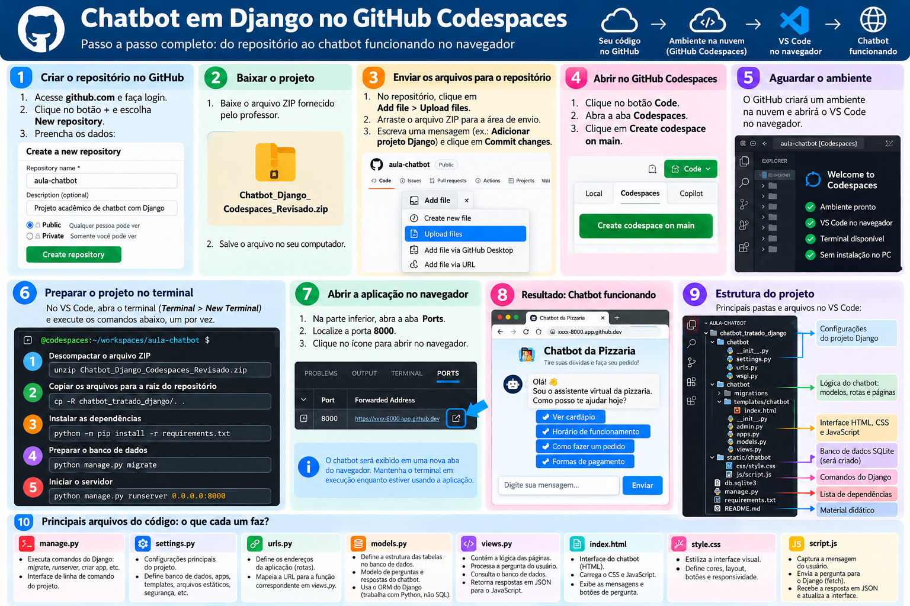

# Guia adicional para iniciantes: `__init__.py`, `main()`, Django, Git, branches e GitHub Codespaces

**Público:** estudantes que estão começando a programar e nunca usaram Git ou Django.  
**Objetivo:** usar este documento como material de consulta durante as atividades no VS Code.

> **Antes de começar:** leia as seções na ordem. Não é necessário memorizar todos os comandos. Copie um comando por vez, leia a explicação e confira a resposta do terminal.

## 1. Visão geral: do GitHub ao chatbot funcionando

A imagem abaixo resume o fluxo de trabalho que usaremos: obter o código, abrir um ambiente de desenvolvimento, preparar o projeto e abrir a aplicação no navegador.



**Atenção:** a imagem é um roteiro visual. Nomes de pastas, nomes de arquivos, aparência dos botões e comandos específicos podem variar entre os projetos. Sempre confira o `README.md` e os arquivos do projeto que o professor disponibilizou. Não substitua os arquivos do seu projeto por nomes que aparecem apenas na ilustração.

## 2. Primeiro, entenda as ferramentas

| Ferramenta/termo | Explicação simples | Quando será usada |
|---|---|---|
| **VS Code** | Editor em que você abre e modifica os arquivos. | Para ler e escrever código e visualizar este Markdown. |
| **Terminal** | Área para digitar comandos. | Para executar Django e comandos Git. |
| **Python** | Linguagem em que a aplicação foi programada. | Para executar o backend e comandos Django. |
| **Django** | Framework web escrito em Python. | Para criar rotas, páginas, lógica do servidor e acesso ao banco. |
| **Git** | Sistema que registra versões dos arquivos. | Para ver o que mudou e guardar versões do trabalho. |
| **GitHub** | Serviço online que hospeda repositórios Git. | Para acessar o código e compartilhar alterações. |
| **GitHub Codespaces** | Ambiente de programação remoto, executado na nuvem. | Para programar e executar o projeto sem instalar as bibliotecas Python no computador do laboratório. |
| **Repositório** | Projeto acompanhado pelo Git. | Guarda arquivos e histórico de alterações. |
| **Branch** | Linha de desenvolvimento separada. | Permite experimentar uma alteração sem trabalhar diretamente na linha principal. |
| **Commit** | Registro de um conjunto de mudanças. | Marca um ponto do histórico do projeto. |
| **Push** | Envia commits ao repositório remoto. | Publica no GitHub os commits feitos no ambiente de trabalho. |
| **Pull** | Baixa e integra mudanças do repositório remoto. | Atualiza a cópia de trabalho com alterações remotas. |
| **Pull Request (PR)** | Proposta para integrar alterações de uma branch a outra no GitHub. | Permite revisão antes de juntar o trabalho. |

## 3. Como abrir este material no VS Code

1. Baixe e extraia o pacote ZIP inteiro.
2. Mantenha o arquivo `.md` e a pasta `imagens` juntos, na mesma pasta principal.
3. Abra essa pasta no VS Code: **Arquivo → Abrir Pasta**.
4. Clique em `GUIA_ADICIONAL_INIT_GIT_CODESPACES.md`.
5. Pressione **Ctrl + Shift + V** para abrir a pré-visualização formatada.

Se você mover apenas o arquivo `.md`, a imagem poderá deixar de aparecer. O caminho da imagem é relativo ao documento: `imagens/passo_a_passo_chatbot_github_codespaces.png`.

## 4. Entendendo os arquivos de um projeto Django

A estrutura exata muda conforme o projeto. Um exemplo comum é:

```text
meu-chatbot/
├── manage.py
├── requirements.txt
├── chatbot_project/
│   ├── __init__.py
│   ├── settings.py
│   ├── urls.py
│   └── wsgi.py
├── chatbot/
│   ├── __init__.py
│   ├── admin.py
│   ├── apps.py
│   ├── models.py
│   ├── urls.py
│   ├── views.py
│   └── migrations/
│       └── __init__.py
├── templates/
│   └── chatbot/
│       └── index.html
├── static/
│   └── chatbot/
│       └── style.css
└── docs/
    └── MATERIAL_DIDATICO.md
```

| Arquivo ou pasta | Para que serve |
|---|---|
| `manage.py` | Executa comandos administrativos do Django, como `check`, `migrate` e `runserver`. |
| `requirements.txt` | Lista as bibliotecas Python necessárias ao projeto. |
| `settings.py` | Guarda configurações do projeto: aplicações, banco, idioma, fuso horário, templates e arquivos estáticos. |
| `urls.py` | Mapeia endereços web para funções ou outras configurações de URL. |
| `views.py` | Contém funções que processam requisições e retornam páginas ou dados. |
| `models.py` | Define os modelos de dados que o Django usa para conversar com o banco. |
| `admin.py` | Configura a apresentação dos modelos no painel administrativo do Django. |
| `apps.py` | Contém a configuração da aplicação Django. |
| `migrations/` | Guarda arquivos que descrevem mudanças na estrutura do banco de dados. |
| `templates/` | Guarda arquivos HTML, que podem conter marcações do sistema de templates Django. |
| `static/` | Guarda CSS, JavaScript e imagens estáticas. |
| `docs/` | Guarda material didático e instruções. |
| `__init__.py` | Arquivo relacionado à organização de uma pasta como pacote Python. |

Os nomes `chatbot`, `chat_integrado` e `empresa_ficticia` podem variar. Não renomeie pastas de um projeto sem atualizar as referências correspondentes.

## 5. O que é `__init__.py`? Vamos entender de verdade

Imagine que um projeto Python seja uma caixa de ferramentas. Dentro dela, você separa ferramentas por assunto: uma pasta para o chatbot, outra para configurações e outra para as migrações do banco. Python precisa conseguir organizar e importar esses arquivos. É aí que entra o conceito de **pacote Python**.

### 5.1 Primeiro: o que é um pacote?

Um **módulo** é normalmente um arquivo Python, por exemplo `views.py`.

Um **pacote** é uma pasta que reúne módulos relacionados. No Django, por exemplo:

```text
chatbot/
├── __init__.py
├── views.py
├── models.py
└── admin.py
```

Aqui:

- `views.py` contém funções que respondem às requisições da página;
- `models.py` define os dados que o Django usa;
- `admin.py` configura o painel administrativo;
- `__init__.py` ajuda Python a tratar a pasta `chatbot` como um pacote Python tradicional.

### 5.2 Por que o nome tem tantos sublinhados?

O nome é escrito exatamente assim — dois sublinhados antes de `init` e dois depois:

```text
__init__.py
```

Os sublinhados fazem parte do nome especial reconhecido pelas convenções do Python. Não escreva `init.py`, `_init_.py` ou `__init.py`: são nomes diferentes.

### 5.3 O que acontece quando Python importa esse pacote?

Quando outro arquivo usa um import como:

```python
from chatbot import views
```

Python localiza o pacote `chatbot` e o módulo `views`. Em um pacote tradicional, o conteúdo de `chatbot/__init__.py` é executado quando o pacote é importado.

O arquivo pode estar **completamente vazio**. Isso é normal. Mesmo vazio, ele marca a pasta como um pacote Python tradicional. Versões modernas do Python também permitem certos pacotes sem `__init__.py`, chamados *namespace packages*, mas neste projeto Django o arquivo faz parte da estrutura tradicional e deve ser mantido.

### 5.4 O que eu devo escrever dentro dele?

**Na atividade atual, normalmente nada. Deixe-o vazio, a menos que o professor ou o código do projeto peça algo específico.**

Por exemplo, não coloque isto em `__init__.py` só para “fazer o projeto iniciar”:

```python
# Não é necessário colocar código aqui só porque o arquivo existe.
```

O Django não precisa que você invente conteúdo para esse arquivo. O servidor é iniciado com `manage.py`, e não com `__init__.py`.

Em projetos maiores, programadores podem colocar inicializações pequenas ou disponibilizar nomes no pacote por meio desse arquivo. Mas o código que fica ali é executado quando o pacote é importado. Por isso, colocar lógica desnecessária pode gerar efeitos inesperados.

### 5.5 Por que existem vários `__init__.py` no projeto Django?

Veja um exemplo simplificado:

```text
meu-chatbot/
├── manage.py
├── chatbot_project/
│   ├── __init__.py
│   ├── settings.py
│   └── urls.py
└── chatbot/
    ├── __init__.py
    ├── views.py
    ├── models.py
    └── migrations/
        └── __init__.py
```

Há três arquivos `__init__.py` porque há três pastas que são organizadas como pacotes:

- `chatbot_project/__init__.py`: pertence ao pacote de configurações do projeto;
- `chatbot/__init__.py`: pertence ao pacote da aplicação do chatbot;
- `chatbot/migrations/__init__.py`: pertence ao pacote que guarda os arquivos de migração do banco.

**O arquivo não executa as migrações e não inicia o chatbot.** Ele faz parte da organização dos pacotes Python.

### 5.6 Atenção: `__init__.py` não é a mesma coisa que `__init__()` de uma classe

Esse ponto confunde muita gente porque os nomes são parecidos.

**`__init__.py` (com `.py`)** é um arquivo que fica dentro de uma pasta e está relacionado a um pacote Python.

**`__init__()` (com parênteses)** é um método especial que pode existir dentro de uma classe. Ele é chamado quando um objeto daquela classe é criado e costuma preparar os valores iniciais do objeto.

Exemplo de método de classe:

```python
class Aluno:
    def __init__(self, nome):
        self.nome = nome

aluno1 = Aluno("Ana")
print(aluno1.nome)
```

Resultado:

```text
Ana
```

Neste exemplo, `__init__` não é um arquivo. É um método da classe `Aluno`, que guarda o nome no objeto criado.

### 5.7 Resumo sem complicação

| Nome | O que é | Para que serve |
|---|---|---|
| `__init__.py` | Arquivo dentro de uma pasta Python | Participa da organização da pasta como pacote Python. Pode ficar vazio. |
| `__init__()` | Método especial dentro de uma classe | Inicializa os dados de um objeto quando ele é criado. |
| `main()` | Função comum, com nome convencional | Muitas vezes coordena o início de um programa, se alguém a chamar. |
| `__main__` | Valor especial de `__name__` ao executar um arquivo diretamente | Permite testar se o arquivo está sendo executado como programa principal. |
| `manage.py` | Arquivo de comandos do Django | Permite executar `check`, `migrate`, `runserver` e outros comandos. |

**O que você precisa guardar para esta atividade:** não execute `__init__.py`; não renomeie nem apague esse arquivo; e não precisa escrever nada nele. Abra `manage.py` e use os comandos Django descritos no `README.md` para iniciar e verificar a aplicação.

### 5.8 Teste rápido

Responda antes de continuar:

1. `__init__.py` é um comando que digitamos no terminal? **Não.**
2. Um `__init__.py` vazio pode estar correto? **Sim.**
3. Ele inicia o servidor Django? **Não.**
4. Qual arquivo usamos para executar comandos como `runserver`? **`manage.py`.**
5. `__init__()` dentro de uma classe é o mesmo que o arquivo `__init__.py`? **Não.**

## 6. O que significa `if __name__ == "__main__":`?

Python cria uma variável especial chamada `__name__` para cada módulo.

- Quando você executa um arquivo diretamente, Python define `__name__` como `"__main__"`.
- Quando outro arquivo importa esse módulo, `__name__` normalmente recebe o nome do módulo.

Veja este exemplo:

```python
print("Esta linha é executada quando o módulo é carregado.")

if __name__ == "__main__":
    print("Este bloco só roda quando o arquivo é executado diretamente.")
```

Se executar o arquivo diretamente, as duas mensagens aparecem. Se outro arquivo importar esse módulo, a primeira mensagem aparece, mas o bloco protegido pelo `if` não roda.

O `if` é útil para separar código que deve rodar apenas quando o arquivo for executado diretamente, como testes simples ou uma chamada para a função principal.

## 7. O que é `main()`? Por que `__init__` não é `main`?

`main()` é apenas o nome que programadores frequentemente escolhem para uma função que coordena o início de um programa. Python não obriga que exista uma função chamada `main`.

Exemplo:

```python
def main():
    print("Olá! O programa começou.")

if __name__ == "__main__":
    main()
```

Leia por partes:

1. `def main():` **define** a função. Definir uma função não executa seu corpo.
2. O código indentado abaixo de `def` é o corpo da função.
3. `if __name__ == "__main__":` verifica se o arquivo foi executado diretamente.
4. `main()` **chama** a função, executando as instruções que estão dentro dela.

### A diferença entre definir e chamar

```python
def cumprimentar():
    print("Olá!")
```

Esse código define a função, mas ainda não imprime `Olá!`.

Para executar a função, é preciso chamá-la:

```python
cumprimentar()
```

### Tabela-resumo

| Expressão | O que significa |
|---|---|
| `def main():` | Define uma função chamada `main`. |
| `main()` | Chama a função `main`. |
| `if __name__ == "__main__":` | Verifica se o arquivo foi executado diretamente. |
| `__init__.py` | Arquivo associado à inicialização/organização de um pacote Python. |
| `manage.py` | Arquivo de entrada para comandos administrativos do Django. |

**Não existe uma equivalência `__init__ = __main__`.** São nomes com finalidades diferentes.

## 8. Como ler o `manage.py` do Django

Um arquivo `manage.py` típico se parece com este exemplo simplificado:

```python
import os
import sys

if __name__ == "__main__":
    os.environ.setdefault(
        "DJANGO_SETTINGS_MODULE",
        "chatbot_project.settings"
    )

    from django.core.management import execute_from_command_line
    execute_from_command_line(sys.argv)
```

O arquivo real do seu projeto pode ter pequenas diferenças. Leia o arquivo fornecido pelo professor e não o substitua pelo exemplo sem necessidade.

### `import os`

Importa ferramentas do Python para interagir com o sistema operacional e com variáveis de ambiente.

### `import sys`

Importa ferramentas do interpretador Python. `sys.argv` contém os argumentos passados no terminal.

Por exemplo:

```bash
python manage.py check
```

O comando `check` é passado ao Django como argumento.

### `os.environ.setdefault(...)`

Define `DJANGO_SETTINGS_MODULE` caso ela ainda não esteja definida. O valor `chatbot_project.settings` indica ao Django onde encontrar as configurações do projeto. O nome `chatbot_project` precisa corresponder à pasta real de configuração.

### `execute_from_command_line(sys.argv)`

Entrega os argumentos do terminal ao sistema de comandos do Django. Assim, o mesmo `manage.py` pode iniciar comandos diferentes:

```bash
python manage.py check
python manage.py migrate
python manage.py runserver
```

## 9. Como o navegador conversa com o Django

Um fluxo comum de chatbot é:

1. O navegador pede a página inicial.
2. O `urls.py` identifica a URL e direciona a requisição para uma view.
3. A view retorna HTML.
4. O navegador interpreta o HTML, aplica o CSS e executa o JavaScript.
5. Quando o usuário envia uma pergunta, o JavaScript faz uma requisição HTTP para uma URL do chatbot.
6. A view recebe a pergunta e pode consultar o banco usando um modelo Django.
7. O servidor devolve uma resposta, muitas vezes em JSON.
8. O JavaScript lê a resposta e atualiza a conversa na tela.

| Termo | Explicação |
|---|---|
| HTML | Estrutura da página. |
| CSS | Aparência: cores, fontes, espaçamento, tamanho e posicionamento. |
| JavaScript | Interações executadas no navegador. |
| Backend | Código executado no servidor, neste caso Python/Django. |
| Frontend | Parte exibida e usada pelo usuário no navegador. |
| URL | Endereço de uma página ou serviço. |
| View | Função que recebe a requisição e produz a resposta. |
| Model | Definição dos dados manipulados pelo Django. |
| ORM | Ferramenta que permite acessar o banco com objetos e métodos Python. |
| JSON | Formato de dados usado na comunicação entre navegador e servidor. |
| CSRF | Proteção contra um tipo de requisição forjada; o Django usa tokens CSRF em formulários e requisições protegidas. |
| HTTP 200 | Resposta de sucesso. |
| HTTP 404 | Recurso não encontrado. |
| HTTP 500 | Erro interno no servidor. |

## 10. Abrir o projeto no GitHub Codespaces

O Codespaces é um ambiente remoto. Os comandos abaixo são executados no ambiente online, não no computador do laboratório.

### Passo 1 — Abrir o repositório

1. Entre em `https://github.com/` com sua conta.
2. Abra o repositório indicado pelo professor.
3. Clique em **Code**.
4. Selecione a aba **Codespaces**.
5. Clique para criar ou abrir um Codespace, se a opção estiver disponível.

O nome e a posição dos botões podem mudar. O professor também pode fornecer um link direto.

### Passo 2 — Abrir o terminal

No ambiente do VS Code, selecione **Terminal → New Terminal**.

Digite:

```bash
pwd
```

`pwd` mostra a pasta atual.

Depois:

```bash
ls
```

`ls` lista arquivos e pastas. Localize a pasta do projeto que contém `manage.py`.

### Passo 3 — Entrar na pasta correta

Exemplo para o projeto Chat Integrado:

```bash
cd projetos/03-chat-integrado
```

Exemplo para o projeto Empresa Fictícia:

```bash
cd projetos/04-empresa-ficticia-chat
```

Os comandos acima só funcionam se a estrutura do repositório for exatamente essa. Confira com `ls` e siga o `README.md` do projeto.

Verifique se `manage.py` está na pasta atual:

```bash
ls
```

Se `manage.py` não aparecer, você está na pasta errada. Use `cd ..` para subir um nível e confira novamente.

### Passo 4 — Instalar dependências no ambiente remoto

```bash
python -m pip install -r requirements.txt
```

Esse comando lê `requirements.txt` e instala as bibliotecas listadas no Codespace. Não instala as bibliotecas no computador do laboratório.

### Passo 5 — Aplicar as migrações do banco

```bash
python manage.py migrate
```

Esse comando aplica ao banco as migrações que já existem no projeto.

Se você alterou `models.py` e o professor orientou a criar uma nova migração, o fluxo geralmente é:

```bash
python manage.py makemigrations
python manage.py migrate
```

Não crie migrações sem necessidade: em uma atividade, siga as instruções do professor e verifique se já há arquivos na pasta `migrations`.

### Passo 6 — Verificar a configuração

```bash
python manage.py check
```

Se a configuração estiver correta, o Django costuma informar que não identificou problemas.

### Passo 7 — Iniciar o servidor

```bash
python manage.py runserver 0.0.0.0:8000
```

Deixe esse terminal aberto enquanto testa a aplicação.

### Passo 8 — Abrir o chatbot

1. Localize a aba **Ports / Portas**.
2. Encontre a porta `8000`.
3. Clique na opção para abrir a aplicação no navegador.
4. Teste os botões e envie uma pergunta.

Para parar o servidor, volte ao terminal e pressione `Ctrl + C`.

> `runserver` é um servidor de desenvolvimento para estudar e testar. Não é a forma recomendada de hospedar um sistema em produção.

## 11. Comandos básicos do terminal

| Comando | Para que serve |
|---|---|
| `pwd` | Mostra o diretório atual. |
| `ls` | Lista arquivos e pastas. |
| `cd nome-da-pasta` | Entra em uma pasta. |
| `cd ..` | Sobe um nível de pasta. |
| `clear` | Limpa a tela do terminal; não apaga arquivos. |
| `python --version` | Mostra a versão do Python. |
| `python -m pip install -r requirements.txt` | Instala as dependências listadas. |
| `python manage.py check` | Verifica problemas comuns na configuração Django. |
| `python manage.py makemigrations` | Gera migrações a partir das mudanças nos modelos. |
| `python manage.py migrate` | Aplica migrações ao banco. |
| `python manage.py runserver 0.0.0.0:8000` | Inicia o servidor Django para desenvolvimento. |
| `Ctrl + C` | Interrompe o programa que está executando no terminal. |

**Atenção:** comandos Django e comandos Git têm funções diferentes. `migrate` altera a estrutura do banco; `git commit` registra mudanças no histórico dos arquivos.

## 12. Git: como acompanhar as mudanças

Git ajuda a registrar versões do código. Três conceitos são fundamentais:

1. **Área de trabalho:** os arquivos que você está editando.
2. **Área de preparação (staging):** mudanças selecionadas para o próximo commit.
3. **Commit:** registro das mudanças preparadas.

### Ver o estado atual

```bash
git status
```

Esse comando informa a branch atual e mostra arquivos modificados, novos ou preparados.

### Ver os commits anteriores

```bash
git log --oneline
```

Mostra uma lista compacta dos registros anteriores.

### Ver a branch atual

```bash
git branch
```

Lista as branches locais. O asterisco `*` indica a branch atual.

### Ver o repositório remoto

```bash
git remote -v
```

Mostra os endereços remotos configurados. É comum o remoto principal chamar-se `origin`, mas o nome pode variar.

## 13. Como salvar mudanças com Git

Depois de alterar arquivos, execute os comandos **um por vez**:

```bash
git status
```

Veja quais arquivos foram alterados.

```bash
git add .
```

Prepara as mudanças da pasta atual e de suas subpastas para o próximo commit. Revise o que será incluído antes de continuar.

```bash
git status
```

Confira o que está preparado.

```bash
git commit -m "Descrever a alteração"
```

Cria um registro no histórico com uma mensagem curta.

Exemplos:

```bash
git commit -m "Adicionar pergunta sobre horário"
git commit -m "Corrigir estilo do chatbot"
git commit -m "Documentar função de envio"
```

Uma mensagem boa diz o que mudou. Evite mensagens vagas como `teste`, `alteração` ou `coisas`.

### Enviar os commits ao GitHub

```bash
git push
```

Envia os commits para o repositório remoto configurado, se a branch estiver associada a uma branch remota.

Se o Git pedir que você indique a branch pela primeira vez, o comando pode ser:

```bash
git push -u origin minha-branch
```

Substitua `minha-branch` pelo nome real da branch. Não copie esse nome literalmente se sua branch tiver outro nome.

### Atualizar sua branch

```bash
git pull
```

Baixa e integra alterações da branch remota acompanhada pela branch atual. Antes de usar, confira `git status` e salve suas alterações importantes.

## 14. O que é uma branch?

Uma **branch** é uma linha separada de desenvolvimento. Imagine `main` como a linha principal. Uma branch nova permite trabalhar em uma mudança sem alterar diretamente a linha principal.

### Criar uma branch e entrar nela

```bash
git switch -c adicionar-pergunta-contato
```

Esse comando cria a branch `adicionar-pergunta-contato` e muda para ela.

Confira:

```bash
git branch
```

Depois de alterar os arquivos:

```bash
git add .
git commit -m "Adicionar pergunta de contato"
git push -u origin adicionar-pergunta-contato
```

O parâmetro `-u` configura a branch remota padrão para futuros `git push` e `git pull` nessa branch.

### Voltar à branch principal

```bash
git switch main
```

Isso funciona se a branch principal se chamar `main`. Alguns repositórios usam outro nome. Confira com `git branch` antes de executar.

### Como integrar a branch

Em atividades individuais, siga a orientação do professor. Em equipes, normalmente as mudanças são revisadas por um **Pull Request** no GitHub antes de serem integradas à branch principal.

Não faça merge se não souber qual branch contém as alterações e qual deve recebê-las.

## 15. Fork, clone, ZIP e Codespaces não são a mesma coisa

| Termo | Significado |
|---|---|
| **Fork** | Cria uma cópia do repositório na conta GitHub do aluno. |
| **Clone** | Copia um repositório Git para um ambiente de trabalho, preservando o histórico. |
| **Download ZIP** | Baixa arquivos do repositório, mas não traz o histórico Git completo como um clone. |
| **Codespace** | Ambiente remoto de desenvolvimento que permite editar e executar o código na nuvem. |
| **Repositório próprio** | Repositório sob a conta do aluno, em que ele pode ter permissão para enviar mudanças. |

Conseguir abrir um repositório público **não significa** ter permissão para enviar commits para o repositório do professor. Para entregar, o professor pode orientar o uso de um fork, de um repositório próprio ou de outro procedimento.

## 16. Fluxo de trabalho recomendado para a atividade

1. Abra o repositório indicado pelo professor.
2. Crie/abra seu Codespace, se estiver usando o ambiente remoto.
3. Entre na pasta do projeto correta.
4. Leia o `README.md` e a documentação em `docs/`.
5. Execute os comandos de preparação indicados no projeto.
6. Inicie o Django e teste o chatbot.
7. Faça uma alteração solicitada na atividade.
8. Execute `git status` e revise o que mudou.
9. Crie uma branch para a atividade, caso o professor peça.
10. Faça `git add`, `git commit` e `git push` conforme as permissões e as instruções da turma.
11. Confira no GitHub se o commit apareceu no repositório/branch esperado.
12. Se foi solicitado Pull Request, abra-o e indique o que você alterou.

## 17. Erros comuns: como investigar sem pânico

### Erro: `manage.py` não encontrado

Você está no diretório errado ou o projeto está em outra pasta.

```bash
pwd
ls
```

Use `cd` para entrar na pasta que contém `manage.py`.

### Erro: CSS retorna `404`

O navegador pediu um arquivo CSS que o servidor não encontrou naquele caminho.

Confira:

1. se o arquivo CSS existe na pasta `static/`;
2. se o template carrega ``;
3. se o caminho da tag `` corresponde à pasta e ao nome do arquivo;
4. se o terminal Django registra uma requisição para o CSS com status `404`.

O comando abaixo pode ajudar a localizar um arquivo estático. Ajuste o caminho ao nome real da aplicação:

```bash
python manage.py findstatic chatbot/style.css
```

### Erro: chatbot informa que não consegue se comunicar

1. Veja se o servidor Django continua executando.
2. Confira se o JavaScript chama a URL correta.
3. Verifique a aba **Network / Rede** nas ferramentas do navegador.
4. Confira a mensagem no terminal do Django.
5. Confirme se o endpoint retorna JSON e se a requisição usa o método esperado.

### Erro: `git push` falha

Comece com:

```bash
git status
git branch
git remote -v
```

Leia a mensagem completa. A causa pode ser autenticação, permissão, nome de branch, conflitos ou configuração do ambiente.

**Não apague a pasta `.git`, não apague arquivos internos do Git e não desative hooks como tentativa aleatória de resolver o problema.** Peça ajuda ao professor com a mensagem completa do erro.

## 18. Checklist antes de entregar

- [ ] Abri a pasta correta.
- [ ] Li o `README.md` e o material didático.
- [ ] Sei explicar, de forma básica, o papel de `manage.py`, `settings.py`, `urls.py`, `views.py` e `models.py`.
- [ ] Entendi a diferença entre `__init__.py`, `__name__`, `__main__` e `main()`.
- [ ] Executei `python manage.py check`.
- [ ] Apliquei as migrações necessárias.
- [ ] Executei a aplicação e testei o chatbot.
- [ ] Revisei as alterações com `git status`.
- [ ] Se solicitado, criei uma branch.
- [ ] Se solicitado e permitido, fiz commit e push.
- [ ] Confirmei que as alterações foram enviadas ao local correto.
- [ ] Mantive a documentação e a pasta de imagens.

## 19. Exercícios de fixação

Responda com suas próprias palavras:

1. O que é um módulo Python?
2. Para que serve `__init__.py`?
3. Um arquivo `__init__.py` vazio pode ser válido? Por quê?
4. Qual é a diferença entre `__init__.py` e `__main__`?
5. O que `def main():` faz? E o que `main()` faz?
6. Para que serve `if __name__ == "__main__":`?
7. Qual é a função de `manage.py`?
8. Qual a diferença entre `git add` e `git commit`?
9. O que é uma branch e por que ela pode ser útil?
10. Qual é a diferença entre `git push` e `git pull`?
11. Qual é a diferença entre GitHub e GitHub Codespaces?
12. Por que abrir um repositório público não garante permissão para enviar alterações?

## 20. Glossário rápido

- **Backend:** lógica executada no servidor.
- **Branch:** linha de desenvolvimento Git.
- **Commit:** registro de mudanças no histórico.
- **CSS:** linguagem de apresentação visual.
- **Endpoint:** endereço de um serviço, como `/chat/`.
- **Framework:** conjunto de ferramentas e convenções para construir aplicações.
- **Frontend:** parte da aplicação exibida no navegador.
- **Git:** sistema de controle de versões.
- **GitHub:** serviço de hospedagem de repositórios Git.
- **GitHub Codespaces:** ambiente de desenvolvimento remoto.
- **HTML:** linguagem de marcação usada na estrutura das páginas.
- **HTTP:** protocolo de comunicação entre navegador e servidor.
- **JSON:** formato de troca de dados.
- **Migração:** arquivo/instrução versionada para alterações na estrutura do banco.
- **Módulo:** arquivo Python importável.
- **ORM:** ferramenta para consultar e alterar dados do banco por meio de objetos Python.
- **Pacote:** conjunto de módulos organizados em uma pasta.
- **Pull Request:** proposta para revisar e integrar mudanças.
- **Repositório:** projeto acompanhado pelo Git.
- **View:** função Django que processa uma requisição e retorna uma resposta.
- **Workspace:** ambiente ou pasta de trabalho aberta no editor.

**Regra de ouro:** antes de executar qualquer comando, confirme a pasta atual com `pwd`, leia o comando e execute um passo por vez.
